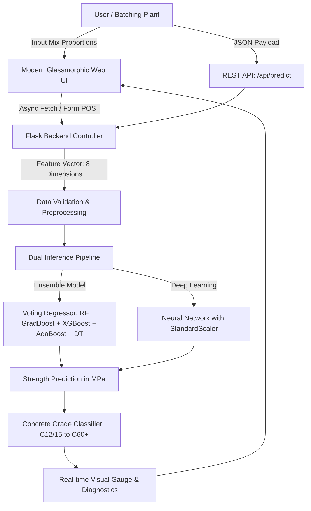

# 🏗️ Concrete Compressive Strength Prediction

[](https://www.python.org/)
[](https://flask.palletsprojects.com/)
[](https://scikit-learn.org/)
[](https://xgboost.readthedocs.io/)
[](LICENSE)
[](https://github.com/Akhassan12)

A civil engineering machine learning platform that predicts the **compressive strength of concrete** ($\text{MPa}$) from raw constituent mix proportions and curing duration.

Designed and maintained by **Ali Hassan Kadri**.

---

## 📌 Executive Summary

Compressive strength is the paramount mechanical indicator used in structural civil engineering to verify safety, load-bearing compliance, and durability. Traditional physical lab tests require standard compressive cylinders or cubes to undergo curing for 7 to 28 days before hydraulic press testing, which causes project delays and prevents rapid mix optimization.

This platform bridges computational intelligence and materials engineering:
- **Dual Predictive Engine**: Evaluates concrete mixtures through an **Ensemble Voting Regressor** ($R^2 = 0.913$, $\text{MAE} = 3.25\text{ MPa}$) and a multi-layer **Neural Network** ($R^2 = 0.863$, $\text{MAE} = 4.16\text{ MPa}$), both evaluated on the same held-out test set.
- **Interactive Modern Interface**: Features a glassmorphic dashboard with live sliders, 1-click industry mix presets, real-time water-to-binder ($w/b$) ratio diagnostics, and automated Eurocode grade classification.
- **Microservice-Ready REST API**: Provides programmatic access (`/api/predict`) for laboratory information management systems (LIMS) and batching plants.

---

## 🏗️ System Architecture



---

## 🔬 Dataset & Input Features

The models are trained on the **UCI Concrete Compressive Strength Dataset** (I-Cheng Yeh, 1998), containing **1,030 records** of concrete mix formulations with measured compressive strengths.

> **Source**: [UCI Machine Learning Repository — Concrete Compressive Strength](https://archive.ics.uci.edu/dataset/165/concrete+compressive+strength)

| Parameter | Feature Name | Unit | Typical Range | Role in Concrete Mix |
| :--- | :--- | :---: | :---: | :--- |
| **Cement** | `cement` | $\text{kg/m}^3$ | $100 - 550$ | Primary hydraulic binder providing hydration products ($C\text{-}S\text{-}H$ gel) |
| **Blast Furnace Slag** | `slag` | $\text{kg/m}^3$ | $0 - 360$ | Supplementary cementitious material; enhances long-term durability |
| **Fly Ash** | `fly_ash` | $\text{kg/m}^3$ | $0 - 200$ | Pozzolanic additive; improves workability and reduces thermal cracking |
| **Water** | `water` | $\text{kg/m}^3$ | $120 - 250$ | Hydrates cement; critically determines the water-to-binder ($w/b$) ratio |
| **Superplasticizer** | `superplasticizer`| $\text{kg/m}^3$ | $0 - 35$ | High-range water reducer ensuring high slump with minimal water |
| **Coarse Aggregate** | `coarse_agg` | $\text{kg/m}^3$ | $800 - 1150$ | Crushed stone/gravel skeleton resisting compressive loads |
| **Fine Aggregate** | `fine_agg` | $\text{kg/m}^3$ | $550 - 1000$ | Natural or manufactured sand filling voids between coarse particles |
| **Curing Age** | `age` | Days | $1 - 365$ | Curing duration in moist conditions prior to destructive test |

**Note on terminology**: The diagnostic shown in the dashboard is the **water-to-binder ratio** ($w/b = \text{water} / (\text{cement} + \text{slag} + \text{fly ash})$), not just water-to-cement, since slag and fly ash act as supplementary binders.

---

## 📊 Model Benchmarks & Comparison

Both models were evaluated on the **same held-out test set** (206 samples, 80/20 split, `random_state=42`):

| Model Architecture | Mean Absolute Error (MAE) | Mean Squared Error (MSE) | Coefficient of Determination ($R^2$) |
| :--- | :---: | :---: | :---: |
| **Ensemble Voting Regressor** ⭐ | **$3.25\text{ MPa}$** | **$22.40\text{ MPa}^2$** | **$0.9131$ ($91.3\%$)** |
| **Neural Network (3-layer, scaled)** | $4.16\text{ MPa}$ | $35.44\text{ MPa}^2$ | $0.8625$ ($86.3\%$) |

### Ensemble Members

The Voting Regressor combines five tree-based regressors (no linear models, which would require feature scaling):

| # | Model | Weight | Individual MAE | Individual $R^2$ |
| :---: | :--- | :---: | :---: | :---: |
| 1 | Random Forest (200 trees) | 3 | 3.78 | 0.881 |
| 2 | Gradient Boosting (300 trees, depth=5) | 4 | 2.84 | 0.928 |
| 3 | XGBoost (300 trees, depth=5) | 9 | 2.97 | 0.924 |
| 4 | AdaBoost (100 estimators) | 2 | 7.06 | 0.710 |
| 5 | Decision Tree (depth=10) | 2 | 4.59 | 0.825 |

### Neural Network Architecture

```
Input (8 features) → StandardScaler → Dense(128, ReLU) → Dense(64, ReLU) → Dense(32, ReLU) → Dense(1, linear)
```
- Optimizer: Adam (lr=0.001)
- Early stopping: patience=20, restore best weights
- Trained for 172 epochs (early stopped from 200)
- The `StandardScaler` is bundled with the model in `NeuralNetwork.pkl`

---

## 🚀 Quickstart Guide

### 1. Clone the Repository
```bash
git clone https://github.com/Akhassan12/Concrete-Strength-Prediction.git
cd Concrete-Strength-Prediction
```

### 2. Set Up a Virtual Environment (Recommended)
```bash
# Windows (PowerShell)
python -m venv venv
.\venv\Scripts\Activate.ps1

# Linux / macOS
python3 -m venv venv
source venv/bin/activate
```

### 3. Install Dependencies
```bash
pip install -r requirements.txt
```

### 4. Launch the Web Application
```bash
python app.py
```
Open your browser and navigate to:
```
http://127.0.0.1:5000
```

---

## 🌐 REST API Documentation

The platform includes a programmatic REST API endpoint for integration into external pipelines.

### Endpoint: `POST /api/predict`

#### Request Headers:
```http
Content-Type: application/json
```

#### Request Body (JSON Example):
```json
{
  "cement": 380.0,
  "slag": 95.0,
  "fly_ash": 0.0,
  "water": 180.0,
  "superplasticizer": 8.0,
  "coarse_agg": 1050.0,
  "fine_agg": 760.0,
  "age": 28
}
```

#### Response (JSON):
```json
{
  "status": "success",
  "prediction": {
    "regression_strength_mpa": 52.48,
    "neural_network_strength_mpa": 50.12,
    "concrete_grade": "C40/50 - High Performance",
    "grade_desc": "High-strength structural grade for heavy commercial buildings, columns, and prestressed components.",
    "water_binder_ratio": 0.38,
    "total_mix_density_kg_m3": 2473.0
  }
}
```

If a model fails to produce a prediction, the corresponding `_strength_mpa` field will be `null` and an `_error` field will explain why. No fallback values are fabricated.

---

## 📂 Project Directory Structure

```plaintext
Concrete-Strength-Prediction/
├── Model/
│   ├── Regression.pkl           # Trained Ensemble Voting Regressor
│   ├── NeuralNetwork.pkl        # Trained Neural Network + StandardScaler
│   └── trained_model.pkl        # Copy of Regression.pkl
├── static/
│   ├── css/
│   │   └── style.css            # Premium glassmorphic design system
│   └── js/
│       └── app.js               # Reactive sliders, presets, and AJAX controller
├── templates/
│   └── index.html               # Responsive HTML5 dashboard
├── Concrete_Data.csv            # UCI dataset (1030 records)
├── app.py                       # Production Flask server & REST API
├── retrain_models.py            # Model retraining script (common split)
├── evaluate_models.py           # Model evaluation & diagnostics script
├── requirements.txt             # Project dependencies
├── LICENSE                      # MIT License (Ali Hassan Kadri)
└── README.md                    # Project documentation
```

---

## 📜 License

This project is open-source software licensed under the **[MIT License](LICENSE)**.

```
Copyright (c) 2026 Ali Hassan Kadri
```

---

## 👤 Author & Ownership

**Ali Hassan Kadri**  
- **GitHub**: [@Akhassan12](https://github.com/Akhassan12)  
- **Email**: [hasanqadri1990@gmail.com](mailto:hasanqadri1990@gmail.com)
